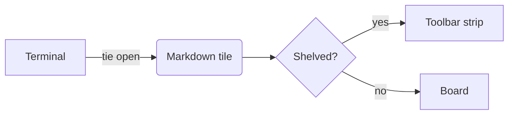
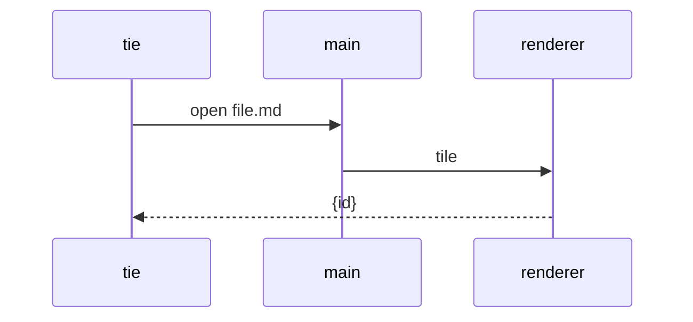
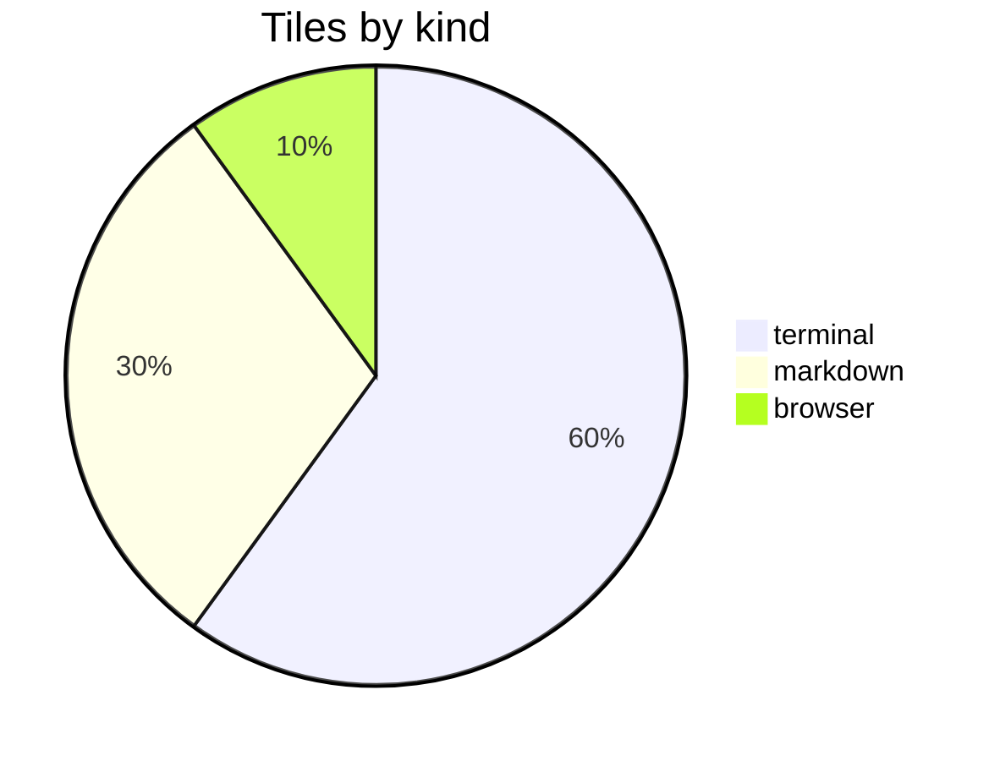
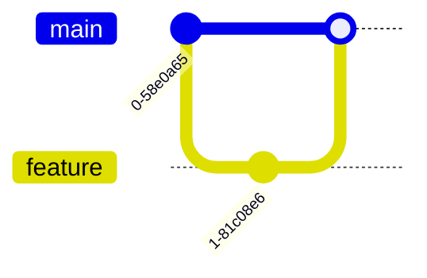

# Markdown showcase

Every syntax the markdown viewer renders, in one file: open it in a dev instance and iterate on `src/viewers/markdown.html`. Headings carry anchors: [jump to tables](#tables), [to code](#code), [to diagrams](#diagrams).

## Headings

# H1 Heading
## H2 Heading
### H3 Heading
#### H4 Heading
##### H5 Heading
###### H6 Heading

Setext style:

Alternate H1
============

Alternate H2
------------

## Paragraphs and inline

A paragraph of running text long enough to wrap in a narrow tile, so line height, measure and paragraph spacing can be judged against the terminal next to it. A second sentence follows, with *emphasis*, **strong**, ***both***, ~~strikethrough~~, `inline code`, and a [link](https://example.com "with a title"). Autolinks too: https://example.com/path?q=1 and www.example.org.

A hard line break follows (two trailing spaces)  
and this is the next line. A backslash break\
also works.

"Smart quotes" and 'single ones', dashes -- and ---, ellipsis... (typographer off: shown as typed). Escapes: \*not emphasis\*, \`not code\`, \# not a heading.

Raw HTML is shown as text, never rendered: <b>bold?</b> <script>alert(1)</script> &amp; &copy; &#x1F600;

Emoji shortcodes: :tada: :rocket: :warning: :white_check_mark: :x: :bulb:

Footnotes[^1] attach notes at the bottom[^long].

[^1]: A short footnote.
[^long]: A longer one, with `code` and a [link](https://example.com).

    Second paragraph of the same footnote, indented.

## Lists

- Unordered item
- Another, with a nested list:
  - Nested item
  - Nested item with **strong**
    - Third level
- Item with a paragraph break

  Second paragraph inside the item, indented.

1. Ordered item
2. Second
   1. Nested ordered
   2. Another
3. Third

7. Starts at seven
8. Eight

* Asterisk bullets
+ Plus bullets

- [ ] Task not done
- [x] Task done
- [ ] Task with `code` and a [link](https://example.com)
  - [x] Nested task

Term
: Definition of the term.

Another term
: First definition.
: Second definition, with *emphasis*.

Loose definition

:   Indented definition paragraph with
    a continuation line.

## Blockquotes

> A quote. Lorem ipsum dolor sit amet, consectetur adipiscing elit, sed do eiusmod tempor incididunt ut labore.
>
> Second paragraph of the quote, with a [link](https://example.com) and `code`.
>
> > Nested quote.
> >
> > - A list inside
> > - the nested quote
>
> ```js
> const inside = 'code in a quote'
> ```

## Tables

| Left | Center | Right |
|:-----|:------:|------:|
| a | b | c |
| longer cell content that wraps when the tile is narrow | `code` | 1,234.56 |
| **strong** | *em* | [link](https://example.com) |

Minimal pipes:

Key | Value
--- | ---
one | 1
two | 2

A wide table (horizontal scroll or squeeze):

| Column one | Column two | Column three | Column four | Column five | Column six | Column seven | Column eight |
|---|---|---|---|---|---|---|---|
| 1 | 2 | 3 | 4 | 5 | 6 | 7 | 8 |

## Code

Indented block:

    indented code block
    second line

Fenced, no language (plain):

```
plain fenced block
  with indentation preserved
```

```bash
#!/usr/bin/env bash
set -euo pipefail
for f in "$@"; do
  echo "processing $f" >&2   # comment
  tie open "$f" --shelved
done
```

```typescript
// TypeScript
interface Tile { id: string; kind: 'terminal' | 'markdown'; exit: number | null }
export function render(tiles: Map<string, Tile>): void {
  for (const [id, t] of tiles) console.log(`${id}: ${t.kind}`, t.exit ?? 'running')
}
const re = /^[a-z]+\d*$/giu
```

```python
import os
from dataclasses import dataclass

@dataclass
class Tile:
    id: str
    kind: str = "terminal"

    def title(self) -> str:
        """Docstring."""
        return f"{self.kind}:{self.id}"  # f-string
```

```rust
#[derive(Debug)]
struct Tile<'a> { id: &'a str, exit: Option<i32> }
fn main() {
    let t = Tile { id: "t1", exit: None };
    println!("{:?}", t);
}
```

```go
package main

import "fmt"

func main() {
	tiles := map[string]int{"t1": 0}
	for id, exit := range tiles {
		fmt.Printf("%s exited %d\n", id, exit)
	}
}
```

```json
{ "theme": "tie-dark", "fontSize": 12, "toolbar": "bottom", "warnPasteRun": true, "tags": ["a", "b"], "nested": { "x": null } }
```

```yaml
appId: com.salezica.tie
mac:
  target: [dmg]
  entitlements: build/entitlements.plist   # comment
```

```diff
--- a/src/renderer/tabs.ts
+++ b/src/renderer/tabs.ts
@@ -1,3 +1,3 @@
-// Tabs: one per space, in the window's top bar.
+// Tabs: one per space, the tab list in the toolbar.
 import { S } from './state'
```

```sql
SELECT id, kind, COUNT(*) AS n FROM tiles WHERE exit IS NULL GROUP BY id, kind ORDER BY n DESC;
```

```css
:root { --accent: #a6cdfa; }
.tile.active .titlebar .glyph { color: var(--accent); }
```

```xml
<toolbar position="bottom"><tabs min="140"/><shelf/></toolbar>
```

```unknownlang
no highlighter for this language: plain text, fence kept
```

A very long line to test horizontal overflow inside code blocks: `const x = ...` and then a fenced one:

```
0123456789 0123456789 0123456789 0123456789 0123456789 0123456789 0123456789 0123456789 0123456789 0123456789 0123456789 0123456789
```

## Images

Relative image from this folder (missing on purpose unless `sample.png` exists):


Remote images never load (no network in viewers): 

## Rules

Three ways:

---

***

___

## Diagrams









A broken diagram (error line expected):

```mermaid
flowchart LR
  A --> 
```

## Mixed

1. A list item holding a table:

   | a | b |
   |---|---|
   | 1 | 2 |

2. A list item holding code:

   ```sh
   echo "inside a list"
   ```

3. A list item holding a quote:

   > quoted inside the list

> Heading inside a quote:
> ### H3 in quote
> - and a task: [x] done

Final paragraph, after everything, to check bottom padding.
